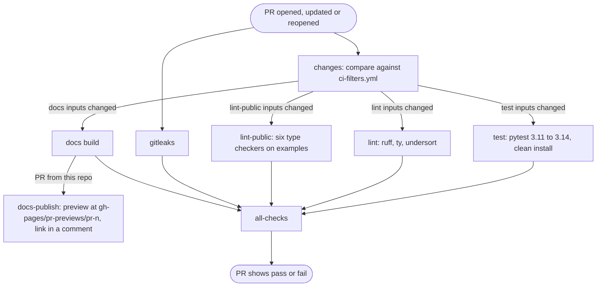
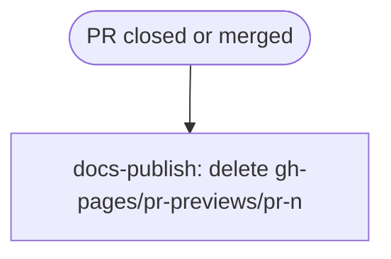
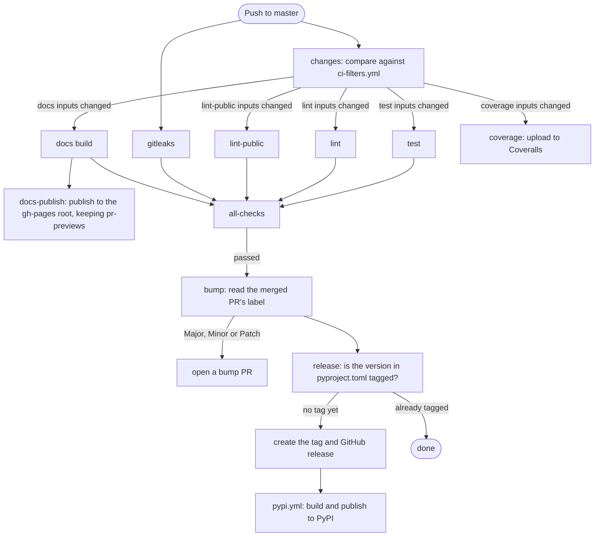
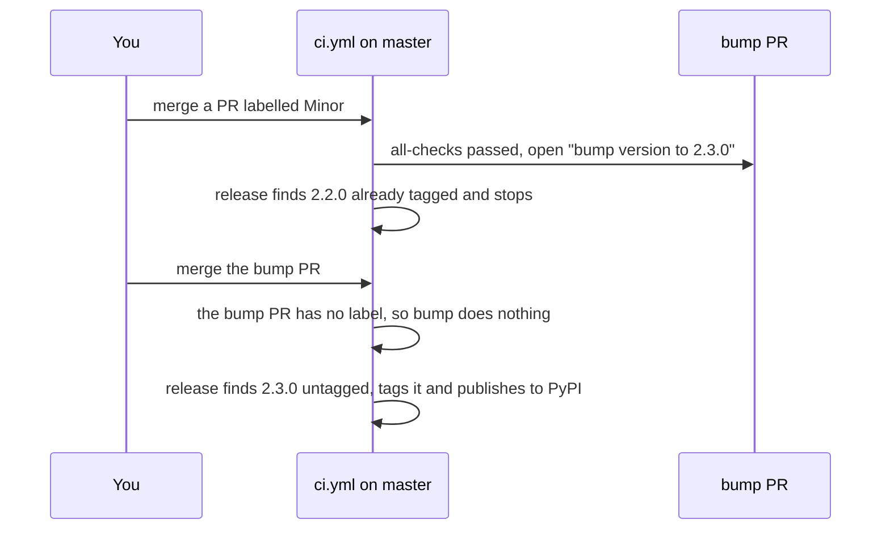

# CI workflows

Every check runs from one workflow, `.github/workflows/ci.yml`. Its first job, `changes`, compares the push or PR against `.github/ci-filters.yml`. Each check only starts when one of its inputs changed, so a docs-only PR doesn't run the tests.

## Workflow files

| File | What it does | Runs when these change |
|---|---|---|
| `ci.yml` | Decides which checks run, then calls them in order. | Every push and PR to `master` |
| `test.yml` | Runs pytest on Python 3.11 to 3.14, and imports the built wheel with only its declared dependencies. | `src/`, `tests/`, `pyproject.toml`, `uv.lock` |
| `lint.yml` (lint) | Runs ruff, ty and undersort on the package. | `src/`, `tests/`, `examples/`, `ruff.toml`, `pyproject.toml`, `uv.lock` |
| `lint.yml` (lint-public) | Runs ruff, ty, pyrefly, zuban, mypy and pyright on `examples/`, the way users call the public API. | `src/`, `examples/`, `ruff.toml`, `pyproject.toml`, `uv.lock` |
| `gitleaks.yml` | Scans the history for leaked secrets. | Every push and PR |
| `docs.yml` | Builds this site. | `src/`, `docs/`, `zensical.toml`, `mkdocs.yml`, `pyproject.toml`, `uv.lock` |
| `docs-publish.yml` | Publishes the built site, as a PR preview or to the root for `master`. It isn't a check, so `all-checks` doesn't wait on it. | Whenever the docs build passed, and when a PR closes |
| `coverage.yml` | Uploads coverage to Coveralls. It's informational, so nothing waits on it. | `src/`, `tests/`, `examples/`, `pyproject.toml`, `uv.lock` |
| `bump-version-by-labels.yml` | Opens a version bump PR from the merged PR's `Major`, `Minor` or `Patch` label. | Pushes to `master` |
| `release.yml` | Tags and releases a version that has no tag yet, then triggers `pypi.yml`. | Pushes to `master` |
| `pypi.yml` | Builds the package and publishes it to PyPI. | A release from `release.yml` |

A change to `ci.yml`, `ci-filters.yml` or `.github/actions/setup/` reruns every check.

Test, lint, coverage and the docs build also cache their result. The cache key hashes the check's inputs, `uv.lock` and its workflow files. On a hit, the check skips its heavy steps, because these exact inputs already passed. The `lint` dependency group pins every lint tool, so a tool upgrade changes `uv.lock` and the key.

## When a PR is opened or updated

A check whose inputs didn't change is skipped, and `all-checks` counts a skipped check as passed. `all-checks` fails only when a check failed or was cancelled, which makes it the one check to require in branch protection.

A newer push to the same PR cancels the older run. PRs from forks build the docs but get no preview, because their token can't push to `gh-pages`.

Publishing runs in one concurrency group per PR and one for `master`, so each PR's preview and the main docs never cancel each other. Previews only write inside `pr-previews/`, so they never change the main docs.

## When a PR is closed

No checks run on close. A merged PR also starts the push flow below.

## When a PR is merged to master

The release job also creates a Sentry release on every run, whether or not the version is new.

Coverage runs next to the checks but isn't part of the chain, so a Coveralls problem never blocks a release.

Each push to `master` gets its own run, so a quick series of merges can't cancel a run and lose its version bump.

## How a release happens

A release takes two merges.

The first merge only opens the bump PR, because the version on `master` hasn't changed yet. Merging the bump PR changes `pyproject.toml`, and the run for that push releases it.
